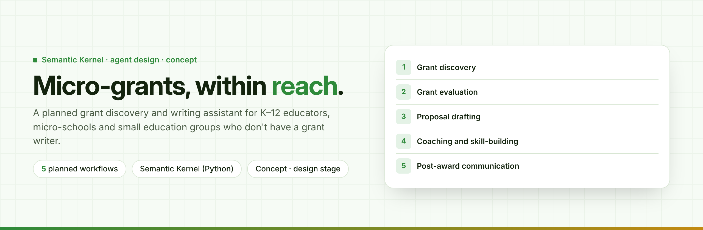

# edugrant_agent

EduGrant Agent – Semantic Kernel Starter

> **Status:** concept. This repo holds the design and planned structure; the starter code isn't checked in yet. 

This repository contains the starter code for the EduGrant Agent, an AI-powered grant discovery and writing assistant built using Semantic Kernel in Python. 

 

🧠 Project Overview 

EduGrant Agent helps K–12 educators, micro-schools, and small educational organizations discover and apply for micro-grants. It supports modular workflows for: 

Grant discovery 

Grant evaluation 

Proposal drafting 

Coaching and skill-building 

Post-award communication 

The agent is designed to reduce barriers for underserved users who typically lack access to professional grant writers. 

 

📁 Project Structure 

edugrant_agent/ 
├── main.py 
├── kernel_config.py 
├── .env 
├── .gitignore 
├── README.md 
├── skills/ 
│   ├── grant_discovery/ 
│   │   └── find_matching_grants.yaml 
│   ├── grant_evaluation/ 
│   │   └── assess_fit.yaml 
│   ├── proposal_drafting/ 
│   │   └── generate_narrative.yaml 
│   ├── coaching/ 
│   │   └── explain_terms.yaml 
 
 

⚙️ Setup Instructions 

Clone the repository  

git clone https://github.com/jkelleman/edugrant_agent.git 

cd edugrant_agent 

Create a virtual environment  

python -m venv venv 

source venv/bin/activate  # or venv\Scripts\activate on Windows 

Install dependencies pip install semantic-kernel python-dotenv 

Configure your environment Create a .env file with your OpenAI credentials: OPENAIAPIKEY=your-openai-api-key OPENAI_MODEL=gpt-4 

Run the agent python main.py 

 

🤝 Contribution Guidelines 

We welcome contributions to improve the EduGrant Agent. Here’s how to get started: 

Fork the repository and create a feature branch. 

Add new skills or improve existing YAML templates. 

Submit a pull request with a clear description of your changes. 

Follow Semantic Kernel best practices for modularity and prompt design. 

Please ensure your contributions align with the MVP focus: supporting small-scale grant seekers in education. 

 

🚀 Future Enhancements 

Planned improvements include: 

Deadline tracking and grant lifecycle management 

Semantic memory for personalized recommendations 

Azure Functions integration for API-based deployment 

Loop component support for collaborative grant writing 

Multi-agent orchestration using AutoGen for complex workflows 

Post-award automation for reporting and sustainability planning 

 
